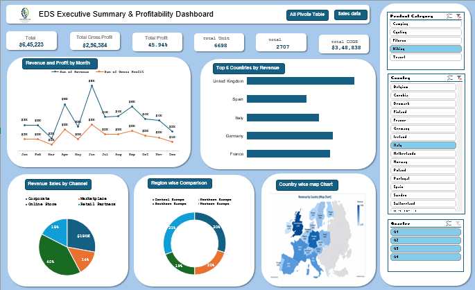

# Sales-Dashboard-in-Excel
Sales Dashboard based on region
# Executive Summary & Profitability Dashboard

This project is an **Excel sales analysis dashboard** that summarizes
revenue, profitability, units sold, sales channels, and regional/country
performance.

## Dashboard Preview

> The image above is displayed from `Dashboard.png`. Keep the image in
> the same folder as this README so it renders correctly on GitHub or in
> a Markdown viewer.

## Key Metrics

  Metric                                     Value
  --------------------------------- --------------
  Total Revenue                       \$645,223.18
  Total Gross Profit                  \$296,384.25
  Gross Profit Margin                       45.94%
  Total Units Sold                           6,698
  Number of Orders / Records                 2,707
  Total Cost of Goods Sold (COGS)     \$348,838.93

*Values are calculated from the `Data` worksheet. Currency values are
rounded to two decimal places.*

## Dashboard Visuals

-   **Revenue and Profit by Month** --- compares monthly revenue and
    gross profit trends.
-   **Top 6 Countries by Revenue** --- compares leading countries by
    revenue.
-   **Revenue Sales by Channel** --- shows how revenue is distributed
    across sales channels.
-   **Region-wise Comparison** --- compares performance across European
    regions.
-   **Country-wise Map Chart** --- provides a geographic view of
    country-level performance.
-   **Slicers / Filters** --- filter the dashboard by product category,
    country, and order/customer-related selections shown in the
    workbook.

## Workbook Structure

The Excel workbook contains these worksheets:

-   **Data** --- source sales records used for analysis.
-   **Pivote Table** --- pivot-table summaries and calculated metrics.
-   **DashBoard** --- dashboard worksheet.
-   **Sheet3** --- an additional worksheet in the workbook.

## Data Fields

The `Data` worksheet contains the following columns:

`ID`, `Order Date`, `Region`, `Country`, `Sales Channel`,
`Customer Type`, `Product Category`, `Product`, `Units Sold`,
`Unit Price`, `Discount %`, `Unit Cost`, `Revenue`, `COGS`,
`Gross Profit`, `Gross Margin %`, `Year`, `Quarter`, `MonthNo`, and
`Month`.

## How to Use

1.  Open `Excel Sales Dashboard.xlsx` in Microsoft Excel.
2.  Go to the **DashBoard** worksheet.
3.  Use the available slicers/filters to explore product categories and
    countries.
4.  Select the **Data** worksheet to review the underlying sales
    records.
5.  If you update or append source records, refresh the workbook's
    PivotTables and charts in Excel so the dashboard reflects the
    updated data.

## Tools Used

-   Microsoft Excel
-   PivotTables and PivotCharts
-   Slicers / interactive filters
-   Geographic map chart

## Files

-   `Excel Sales Dashboard.xlsx` --- Excel workbook containing the data
    and dashboard.
-   `Dashboard.png` --- screenshot preview embedded above.
-   `README.md` --- project overview and documentation.

## Notes

-   Dashboard results depend on the source data and the workbook's
    PivotTable refresh state.
-   The screenshot is a preview; interact with the slicers and charts in
    the Excel workbook itself.

